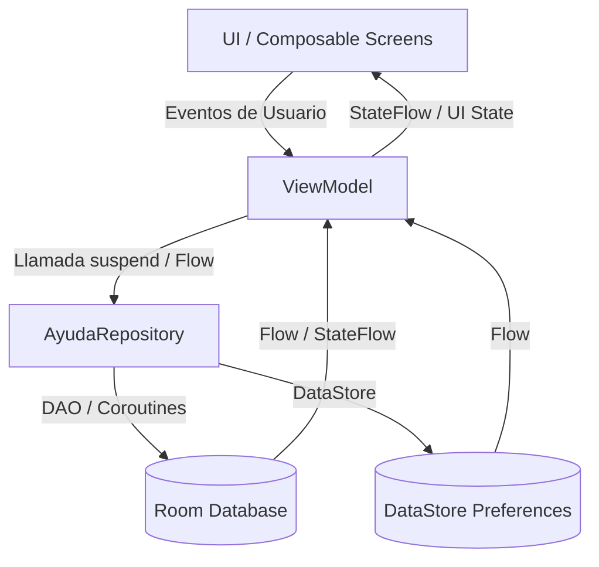
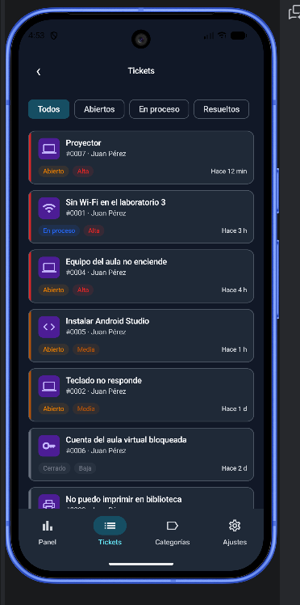

# AyudaCampus - Sistema de Gestion de Tickets Academicos (Fase 1)

Aplicacion Android desarrollada en Jetpack Compose y Kotlin para la gestion de incidencias y tickets en el campus universitario. Permite un flujo completo tanto para estudiantes como para el personal de Soporte Tecnico TI.

---

## Arbol de Paquetes
```text
com.tecsup.ayudacampus/
├── data/
│   ├── local/
│   │   ├── dao/ (CategoriaDao, TicketDao, UsuarioDao)
│   │   ├── entity/ (Categoria, Comentario, Ticket, Usuario)
│   │   ├── relation/ (TicketConDetalle)
│   │   ├── AyudaDatabase.kt
│   │   └── DatosIniciales.kt
│   ├── prefs/ (PreferenciasStore - DataStore)
│   └── repository/ (AyudaRepository, AyudaRepositoryRoom)
├── model/ (ConteoCategoria, EstadoTicket, Prioridad, Rol)
├── ui/
│   ├── cliente/ (DetalleTicketScreen, LoginScreen, MisTicketsScreen, NuevoTicketScreen, PerfilScreen, SplashScreen)
│   ├── components/ (AppTopBar, AyudaButton, AyudaTextField, BurbujaComentario, EstadoChip, Estrellas, PrioridadChip, StepperTicket, TicketCard, graficos/)
│   ├── navigation/ (NavAyuda, Rutas)
│   ├── soporte/ (AjustesScreen, AtenderTicketScreen, BandejaScreen, CategoriasScreen, FormularioCategoriaScreen, PanelScreen)
│   └── theme/ (Color, Theme, Type)
└── viewmodel/ (AtenderViewModel, AyudaViewModelFactory, BandejaViewModel, CategoriasViewModel, MisTicketsViewModel, NuevoTicketViewModel, PanelViewModel, SesionViewModel, TicketDetalleViewModel)
```

---

## Diagrama de Arquitectura (MVVM)


---

## Capturas de Pantalla (Pruebas de Aceptacion)

### 1. Login con clave incorrecta


### 2. Estudiante: crear ticket vacio


### 3. Estudiante: crear ticket valido


### 4. Soporte: bandeja de tickets


### 5. Soporte: pasar a En proceso y responder


### 6. Soporte: intentar cerrar un ticket


### 7. Soporte: marcar como resuelto


### 8. Estudiante: reabrir un ticket resuelto


---

## Para Pensar (Preguntas y Respuestas)

| Pregunta | Tu respuesta |
| :--- | :--- |
| **¿Por qué las reglas de estado están en el ViewModel y no en el DAO ni en el Composable?** | Porque el ViewModel debe manejar la logica de negocio. El DAO solo trabaja con los datos y el Composable solo muestra la interfaz. |
| **¿Por qué crearTicket es suspend y observarTicket es Flow?** | Porque crearTicket realiza una accion puntual, mientras que observarTicket debe actualizar los datos automaticamente cuando cambian. |
| **¿Qué pasaría si un ticket pudiera cerrarse sin calificacion?** | No se cumpliria la regla de negocio y se perderia la valoracion del estudiante sobre la atencion recibida. |
| **¿Qué debería cambiar si mañana los tickets viven en un servidor?** | Principalmente cambiaria la implementacion del Repository para obtener los datos desde una API, sin tener que modificar los ViewModels ni las pantallas. |
